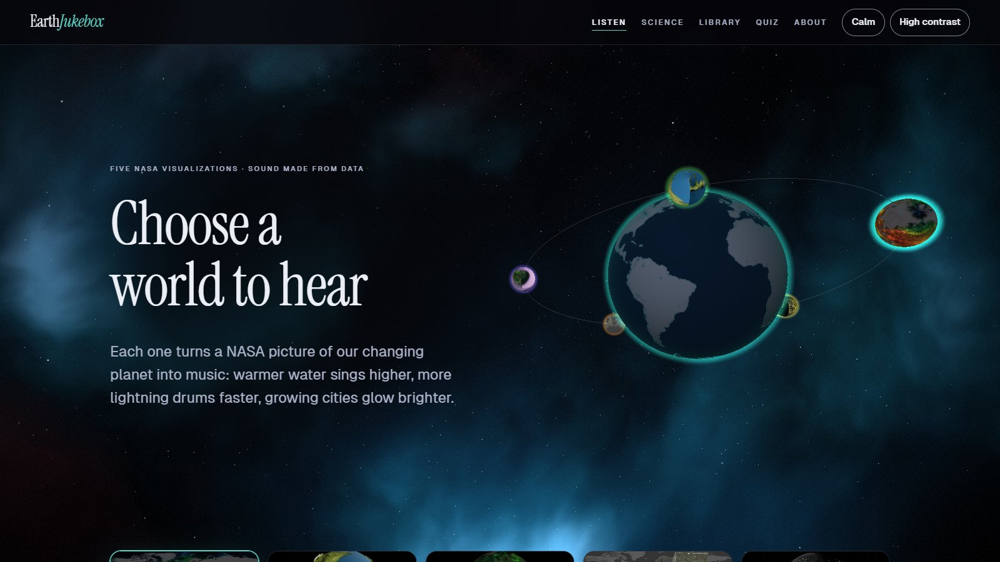
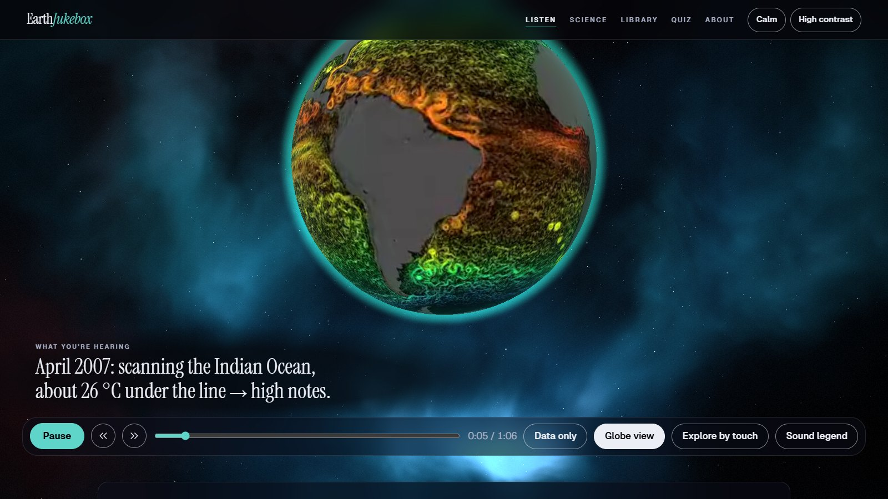
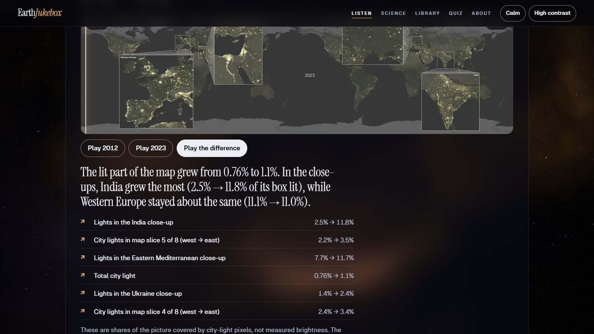
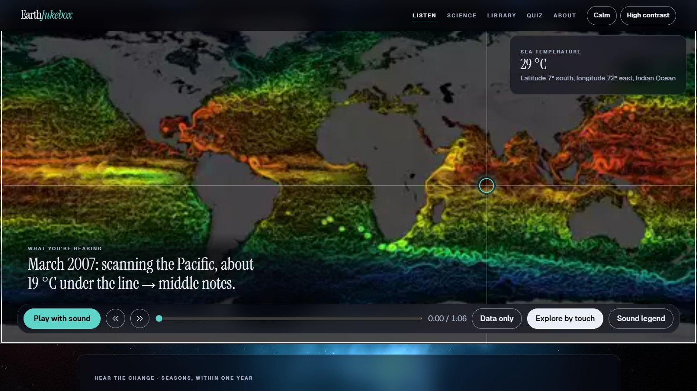

# Earth Jukebox

**Hear NASA’s pictures of our changing planet.**
NASA Space Apps Challenge 2026 · team **Earthsong** · *Earth Jukebox* challenge

**[▶ Open the app](https://711nishtha.github.io/earthsong-jukebox/)** · [Slide deck](https://711nishtha.github.io/earthsong-jukebox/deck/) · [The science](https://711nishtha.github.io/earthsong-jukebox/science/) · [Library](https://711nishtha.github.io/earthsong-jukebox/playlist/) · [Quiz](https://711nishtha.github.io/earthsong-jukebox/quiz/)



Five NASA Scientific Visualization Studio animations become music, **live from the video frames**. The browser reads each frame about 15 times a second against NASA’s own colour bar and turns the values into sound: warmer water sings higher, more lightning drums faster, growing cities glow brighter. It is built for **blind and low-vision listeners first**.

## What you can do

| Listen | Hear the change | Explore by touch |
|---|---|---|
|  |  |  |
| Each visualization plays as music, with spoken captions. | City lights in 2012, then 2023, then only the difference. | Move a crosshair and hear the value under it: “29 °C, Indian Ocean”. |

There's also a close-your-eyes listening quiz, and every soundscape can be downloaded as an MP3 with a transcript.

## The data

| Track | NASA SVS visualization | What you hear |
|---|---|---|
| Ocean Heat | [3912](https://svs.gsfc.nasa.gov/3912/) Sea surface currents and temperature (ECCO2) | A marimba sweep: warmer water plays higher notes |
| Forest Heights | [4950](https://svs.gsfc.nasa.gov/4950/) GEDI forest height | Notes rise with canopy height |
| Four Winds | [5572](https://svs.gsfc.nasa.gov/5572/) GEOS aerosols | Dust, smoke, salt and sulfate, one instrument each |
| City Glow | [5313](https://svs.gsfc.nasa.gov/5313/) Night lights 2012–2023 (Black Marble) | A chord that glows with city light |
| Storm Drums | [5011](https://svs.gsfc.nasa.gov/5011/) ISS lightning 2017–2023 (LIS) | A drum hit for each burst of lightning |

The sound design follows NASA’s [Caldwell 73 sonification](https://svs.gsfc.nasa.gov/13786/).

## Why you can trust it

- **r = 0.93.** That is the median correlation between the sound we play and the data, measured end to end over 32 mappings ([docs/fidelity.md](docs/fidelity.md)).
- **Every sound is labelled** as tested data, approximate data or an artistic choice ([docs/mappings.md](docs/mappings.md)).
- **Accessibility 100** in Lighthouse on all five pages, with 0 axe violations (WCAG 2.1 AA). Everything works by keyboard and screen reader, with high-contrast and Calm modes.
- **Safe audio:** a limiter is always on and the output never goes above −1 dBFS.

## Run it

```bash
npm install
npm run dev     # http://localhost:5173
npm test        # 50 unit tests
npm run build   # static site in dist/
```

The project is a static site built with Svelte 5, TypeScript, Vite, Tone.js and Three.js. It needs no backend and no API keys. Media preparation scripts are in [scripts/](scripts/), and the sources are listed in [docs/resources.md](docs/resources.md).

## Credits

- **Visualizations:** NASA’s Scientific Visualization Studio and partners. Credits for each track are in the app and in `public/media/manifest.json`.
- **Endorsement:** the NASA logo is not used, and this project is not endorsed by NASA.
- **Sound and fonts:** all sound is synthesized with Tone.js; no recorded music or samples are used. Fonts: Instrument Serif and Geist (OFL).
- **AI disclosure:** built by a solo developer with substantial help from an AI coding assistant (Claude, by Anthropic). The assistant wrote much of the code and documentation under the developer’s direction. No AI-generated data, imagery or audio is used.
