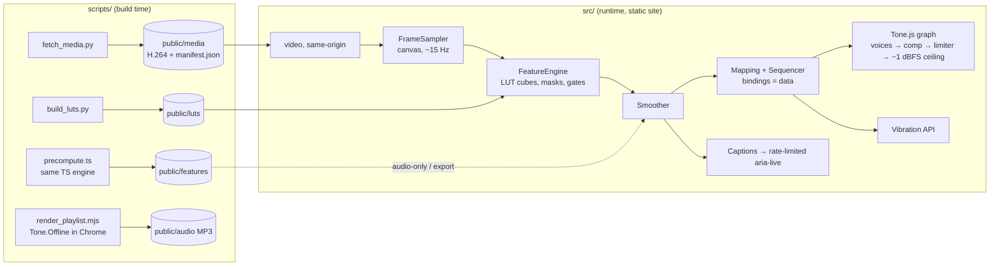

# Earth Jukebox

**Live:** https://711nishtha.github.io/earthsong-jukebox/ · [Science](https://711nishtha.github.io/earthsong-jukebox/science/) · [Library](https://711nishtha.github.io/earthsong-jukebox/playlist/) · [Quiz](https://711nishtha.github.io/earthsong-jukebox/quiz/) · [About](https://711nishtha.github.io/earthsong-jukebox/about/)

**Hear NASA’s pictures of our changing planet.** Earth Jukebox is a web app for the 2026 NASA Space Apps Challenge (*Earth Jukebox* challenge, team **Earthsong**). You pick a NASA Earth Information Center visualization, press play, and hear a soundscape that is **generated live from the video frames**. Colour, brightness, coverage and motion drive pitch, tempo, loudness, timbre and stereo position.

It is built **for blind and low-vision listeners first**:
- Everything works by keyboard and screen reader.
- Rate-limited spoken captions explain what is changing.
- Every sound is described in a legend that labels how data-faithful it is.

| Track | NASA SVS source | What you hear |
|---|---|---|
| A1 Ocean Heat | [3912 Sea Surface Currents and Temperature](https://svs.gsfc.nasa.gov/3912/) | A marimba sweeps west→east playing the sea temperature under a scan line (colour bar 0–32 °C) |
| A2 Forest Heights | [4950 GEDI Forest Height](https://svs.gsfc.nasa.gov/4950/) | Plucked notes rise with canopy height (0–50 m colour bar); tall forest adds a shimmer |
| A3 Four Winds | [5572 GEOS Aerosols](https://svs.gsfc.nasa.gov/5572/) (linked from [5669](https://svs.gsfc.nasa.gov/5669/)) | Dust, smoke, sea salt and sulfate each get their own instrument |
| A4 City Glow | [5313 Night Lights 2012–2023 (EIC)](https://svs.gsfc.nasa.gov/5313/) | A west→east chord glows with city lights; rising bells for more light, falling notes for less |
| A5 Storm Drums | [5011 ISS Lightning 2017–2023](https://svs.gsfc.nasa.gov/5011/) | Soft drums for new lightning, thunder for how much there is |

## What's in v2
- **Enter:** a procedural WebGL nebula and starfield. Pressing Enter unlocks audio, swells a drone and flies you through the stars to Earth. There is a Skip option and a Calm mode.
- **Orbit selector:** a 3D Earth (land mask from SVS 3912) with five track "moons", mirrored by an accessible radio group.
- **Immersion player:** Ocean Heat's live data is wrapped onto the globe. The nebula, stars and halo react to the same data as the sound (from the mapping bindings, never an FFT). It has stem faders and a legend drawer.
- **Hear the change:** City Glow 2012 → 2023 and Ocean Heat March → August, as A, B and only-the-difference. The summaries are written from the measured data.
- **Instrument mode:** pause, then drag or use the arrow keys to hear the value under the crosshair, with latitude/longitude where the projection allows.
- **Proof:**
  - End-to-end fidelity metrics: median r = 0.93 over 32 data mappings.
  - A "Close your eyes" listening quiz generated from the data, with an optional anonymous results backend (`docs/quiz-backend.md`).

## Quick start

```bash
npm install
npm run dev        # http://localhost:5173
npm test           # 33 unit tests (analysis, mapping, captions, config cross-checks)
npm run build      # static site in dist/
```

The processed media, colour-bar lookup tables, precomputed features and playlist MP3s are committed, so the app runs straight after `npm install`. To rebuild them from NASA’s originals, run the pipeline below.

## Pipeline (reproducible)

```bash
pip install -r scripts/requirements.txt         # numpy, Pillow (Python 3.10+, ffmpeg on PATH)
python scripts/fetch_media.py                    # download SVS media → H.264 web copies + manifest.json (live SVS credits)
python scripts/build_luts.py                     # colour bars → public/luts/*.json
python scripts/validate_luts.py                  # honesty gate: colour→value round-trip on the shipped videos
npx vite-node scripts/precompute.ts              # same TS analysis engine over ffmpeg frames → public/features/*.json
npx vite-node scripts/gen_docs.ts                # mapping tables in docs/mappings.md, generated from the configs
node scripts/render_playlist.mjs                 # MP3s for /playlist via the app's own renderer in Chrome
python scripts/build_globe.py                    # globe land mask from the SVS 3912 still
npx vite-node scripts/build_compare.ts           # Hear-the-change stills + docs/hear-the-change.md
npx vite-node scripts/build_quiz.ts              # listening quiz, generated from the data
npx vite-node scripts/fidelity.ts                # end-to-end fidelity metrics (public/fidelity.json, docs/fidelity.md)
node scripts/build_og.mjs                        # share images
node scripts/smoke_browsers.mjs <preview-url>    # Chrome/Firefox/WebKit smoke test of a built site
```

## Architecture



- **`src/analysis/`** is a DOM-free feature engine. Colour gates and colour-bar lookups are baked into 64³ RGB cubes, so each pixel costs one array read (≈0.5–1.5 ms per tick). The browser and the Node precompute run the same code.
- **`src/audio/`** holds the pure mapping layer (`evaluate`, `Sequencer`), the Tone.js graph factory (works live and inside `Tone.Offline`), the live player, the offline renderer and legend previews.
- **`src/tracks/`** has one config per visualization: analysis (size, masks, extractors), sound (layers, bindings), plain-language description, science notes and the caption function.
- **`src/ui/`, `src/pages/`** are the Svelte 5 components: the jukebox, `/about/` and `/playlist/`. It is a multi-page Vite build, so real URLs work on GitHub Pages.

## Add a new visualization

1. Add an entry to `scripts/media_sources.json` (SVS page, video URL, credit line, colour bar URLs, transcode size) and run `python scripts/fetch_media.py --only <id>`.
2. If it has a numeric colour bar, add it to `scripts/build_luts.py` (bar rows, columns and value range). Run that, then run `validate_luts.py` and record the result in `docs/mappings.md`.
3. Create `src/tracks/<id>.ts` exporting a `TrackConfig`:
   - `analysis`: resolution, masks for labels and colour bars, extractors (`continuous`, `scan`, `categories`, `gate`, `regions`, `motion`, `timeline`).
   - `sound`: tonic, scale, layers, and **bindings**. Each binding maps one feature to one parameter and carries its documentation and an honesty label.
   - `description`, `science`, `caption(features)`.
4. Add it to `TRACKS` in `src/tracks/index.ts`.
5. Run `npx vite-node scripts/precompute.ts <id>` and look at the printed feature ranges. Set the binding `in` ranges from them, then run `npm test`; the tests check every binding against the real feature names.
6. Run `npx vite-node scripts/gen_docs.ts` and `node scripts/render_playlist.mjs <id>`.

No engine code changes are needed.

## Accessibility

- WCAG 2.1 AA target. axe-core reports 0 violations and Lighthouse accessibility is 100 on all three pages.
- Text contrast is AAA everywhere; there is a high-contrast theme, and `prefers-reduced-motion` and `prefers-contrast` are respected.
- Full keyboard control:
  - `Space`/`K` play, `←`/`→` seek, `1`–`5` choose a track, `M` data-only mode, `A` audio only, `L` legend.
  - Visible focus; targets of 44 px or more.
- Spoken captions go through an `aria-live` region (off, brief or detailed), at most one message every 9–16 s.
- Each visualization has a long description, and each soundscape has a timed transcript.
- Audio-only mode; a photosensitivity warning and reduce-flashing option (on by default for lightning); haptic pulses on phones.
- The typeface is Atkinson Hyperlegible, which was designed for low-vision readers.
- What was tested, and what was not, is in [docs/testing.md](docs/testing.md).

## Honesty and safety

- Every mapping is labelled *Data (tested)*, *Data (approx.)*, *Data (categorical)*, *Data (relative)*, *Visual* or *Artistic*, plus *amplified* where a small range is stretched. Evidence for each label is in [docs/mappings.md](docs/mappings.md).
- Audio always passes through a compressor, a limiter and a hard soft-clip ceiling at −1 dBFS. Note rates and hit velocity are capped. Measured peaks are in docs/testing.md.

## Docs

- [docs/resources.md](docs/resources.md): every NASA source, fetched live, with media, colour bars and credits.
- [docs/plan.md](docs/plan.md): plan, risks and decisions.
- [docs/mappings.md](docs/mappings.md): generated mapping tables and validation evidence.
- [docs/testing.md](docs/testing.md): what was tested and how.
- [docs/submission.md](docs/submission.md): Space Apps submission text.

## Credits

- **Visualizations:** NASA’s Scientific Visualization Studio (SVS) and partners. The per-track credit lines, people and datasets are in `public/media/manifest.json` (pulled from the SVS API), and in the app under each track and on `/about/`. The videos were resized and re-encoded for the web; nothing else was changed.
- **Reference:** [Data Sonification: Caldwell 73](https://svs.gsfc.nasa.gov/13786/), NASA’s Goddard Space Flight Center; sonification by SYSTEM Sounds (M. Russo, A. Santaguida).
- **Audio:** fully synthesized with [Tone.js](https://tonejs.github.io/) (MIT). No recorded music, samples or loops.
- **Font:** Atkinson Hyperlegible (SIL Open Font License), self-hosted via Fontsource.
- **Endorsement:** the NASA logo is not used, and this project is not endorsed by NASA.

## AI-assisted development (disclosure)

This project was built by a solo developer with substantial help from an AI coding assistant (Claude, by Anthropic):
- It researched the NASA pages and wrote most of the code, tests and documentation, under the developer’s direction and review.
- All data and imagery come from the NASA SVS pages listed above. No AI-generated data, imagery or audio samples are used.
