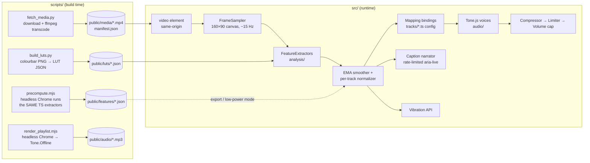

# Earth Jukebox — Plan (Phase 0)

Team Earthsong · NASA Space Apps 2026 · solo build. Sources and media facts: [resources.md](resources.md).

## 1. What we're building
A static web "jukebox". The user picks one of 5 NASA SVS visualizations and presses play. A soundscape is then
**generated live from the video frames**: the browser reads each frame at low resolution, turns
colour into data values via the visualization's own colourbar, and drives a calm, musical synth.
Everything works by keyboard and screen reader. An audio-only mode, a mapping legend with sound
previews, and downloadable WAV/MP3 files make it usable without sight and without a fast device.

## 2. MVP track picks (proposed, see Question 1)
| # | Track (working title) | SVS source | Media we'll ship | Why it's in |
|---|---|---|---|---|
| 1 | **Ocean Heat** | 3912 Sea Surface Currents & Temperature | `ecco2_sst_flow.webmhd.webm` (1080×540, 66.7 s) → H.264 | Only source where the colourbar inversion is **tested and plausible** (hue → 0–32 °C). Flat map, no labels. Our "data-faithful" flagship. |
| 2 | **Forest Heights** | 4950 GEDI Forest Height | `GEDI_global_w_colorbar_1080p60.mp4` (51.5 s, 17.7 MB) | Numeric bar (0–≥50 m), approximate inversion, beautiful and calm. Small file. |
| 3 | **Storm Drums** | 5011 ISS Lightning | `iss_lightning_sphere_07312023.mp4` (216.7 s) → **trimmed** | Most distinct sound: percussive events. Needs photosensitivity handling. |
| 4 | **Four Winds** | 5669 → **5572** GEOS Aerosols (animation) | `Aerosols_EarthRotating_1920x1080.mp4` (60 s) | Four categorical colours → four instrument stems (multi-track, as the brief suggests). 5669 is a still now; 5572 is linked from it. |
| 5 | **City Glow** | 5313 Night Lights (EIC) | 8K HEVC (43.3 s) → 1280×360 H.264 | Very high contrast; the time series plus the "more light / less light" change map gives a clear story. |
| alt | **Rising Air** | 5196 DYAMOND CO₂ | orbit (39.2 s, 6.9 MB HEVC) | Strongest climate-urgency story (380–460 ppm bar), but the opacity blend makes values approximate. Swap-in for #5 if you prefer. |

Not picked:
- 5425 Perpetual Ocean 2: 0.9–1.2 GB per 1080p file, 5 min long.
- 4960 Atmospheric River: 789 MB, 5 min, layered transparent colourbars.
- 5533 Air Quality: no numeric colourbar, 4 strips with different ramps.

All of these remain candidates for later.

## 3. Cross-track sound grammar (learnable, consistent across all tracks)
Blind users learn one "language" and reuse it on every track:
| Visual → | Always becomes → |
|---|---|
| **Data value** read from the colourbar (temperature, height, ppm) | **Pitch**: higher value = higher note, quantized to the track's scale |
| **How much** of something is on screen (coverage, density) | **Loudness and note density** |
| **Where** it is, left ↔ right | **Stereo pan** |
| **North ↔ south** (frame top ↔ bottom) | **Register of the scan voice** (north higher), for flat maps only |
| **Category** (aerosol type, more vs. less light) | **Instrument / timbre** (the Caldwell 73 convention: colour class → instrument) |
| **Sudden events** (new lightning, onsets) | **Percussive hits** (+ haptic pulse on mobile) |
| **Visual motion** (frame-to-frame change) | **Filter brightness / shimmer** (labelled *visual*, never data) |

Plus a **scan voice**, borrowed from Caldwell 73's "radar" sweep. On flat maps, a read-head sweeps west→east every N seconds and plays the value under it. The read-head is drawn on the video so sighted and blind users share the same reference.

## 4. Architecture

Key decisions inside the architecture:
- **One source of truth for feature math.** Extractors live only in TypeScript (`src/analysis/`).
  - Precomputed feature tracks are produced by running those same modules in headless Chrome (Playwright) over the shipped video.
  - Python never re-implements feature math. Python only fetches and transcodes media and turns colourbar images into LUT data.
- **Export uses features, not video.** `Tone.Offline` can't read a video, so "Download soundscape" replays `public/features/<track>.json` through the same mapping and voices.
  - The `/playlist` MP3s are rendered the same way by a headless-Chrome script.
  - Result: the live and offline sound are identical by construction.
- **Fast colour→value lookup.** Each LUT is baked into a 32×32×32 RGB cube (32 K entries) at load time, so every pixel is one array read. That keeps the analysis tick well under 5 ms for 160×90 = 14,400 px.
  - Mode `hue` (SST) or `rgb` (GEDI, CO₂) per track.
  - A "no match" sentinel when the colour is too far from the bar.
- **Frame timing:** `requestVideoFrameCallback` where supported (Chrome, Safari), with a `setInterval` fallback (Firefox), throttled to about 15 Hz.
- **Per-track ROI and masks live in the config**, not in code (see §6). These are rectangles plus colour gates, in normalized 0–1 coordinates.
- **Pages:** Vite multi-page build (`index.html`, `playlist/index.html`, `about/index.html`). That gives real URLs that work on GitHub Pages with no router hacks. Vite `base` is set for the repo path.
- **Audio safety:** a master `Compressor → Limiter(−1 dBFS) → Volume` chain is always on, with user volume capped at −6 dB.
  - Every parameter change is ramped (≥ 50 ms; ≥ 300 ms for gain).
  - Hit velocities are capped.
  - Audio starts only on a user gesture.

## 5. Media plan (Phase 1)
- **Download:** `scripts/fetch_media.py` (Python 3 + ffmpeg).
  - It downloads into `.cache/` (gitignored) and transcodes with `libx264`, `yuv420p`, `-movflags +faststart`, `-g 15` (a short GOP so scrubbing and seeking are snappy), `-an`, and CRF ~26–30.
  - Output goes to `public/media/`.
  - It writes `manifest.json` (source URL, SVS id, credit line, people, dataset credits, dates, sha256, our transcode settings).
- **Target sizes:**
  - 640–960 px wide for 16:9 globes; 1080×540 for SST; 1280×360 for Night Lights (32:9).
  - Plus a 480 px WebP poster per track (≈ 30 KB).
- **Lightning:** trimmed (proposal: the first ~70 s, which covers 2017 → early 2019). Not sped up, because speeding up would raise the flash rate.
- **Budget:** each file < 15 MB, total media ≈ 40–60 MB, committed directly (no LFS; GitHub hard limit is 100 MB per file).
  - The **initial page load is under 5 MB**: the app shell plus posters only. A video loads only when its track is chosen (`preload="none"`).
- **Night Lights timeline:** the year label is burned into the video. I'll annotate frame ranges (year N, fade, change map, zoom pop-outs) by stepping through frames and store them as `timeline` data in the track config. This is **manual annotation**, documented as such.

## 6. Per-track configs, masks and mapping tables
> **Superseded (Phase 3):** the tables below were the Phase 0 draft. The real, current mappings are generated from `src/tracks/*.ts` into [mappings.md](mappings.md) (`npx vite-node scripts/gen_docs.ts`). Some draft rows were dropped or changed after measuring the features (e.g. Ocean Heat's north/south pan; Storm Drums' linear dates).

Columns follow the brief: `Visual feature | How measured | Audio parameter | Range | Data or artistic? | Why`.
"Data (tested)" = colourbar inversion round-trip passed (resources.md). "Data (approx.)" = inversion possible but biased. "Data (relative)" = real data, no numeric scale. "Visual" = depends on rendering or camera, not data. **"Pending Phase 1 validation"** means I'll re-run the round-trip test on the transcoded H.264 file and record the result in `docs/mappings.md` before claiming the label.

### 6.1 Ocean Heat — 3912 (mood: awe; D Dorian, warm pads)
- **ROI:** full frame.
- **Masks:** land (gray, low saturation) and empty ocean (dark) are excluded by an HSV gate (S > 0.35, V > 0.12).
- **LUT:** `sst_ecco2_cbar.png`, hue mode, 0–32 °C.
- **Time → date:** linear, 2007-03-25 → 2008-03-03 over 66.7 s. This is an assumption: the page gives the range but not the frame spacing.

| Visual feature | How measured | Audio parameter | Range | Data or artistic? | Why |
|---|---|---|---|---|---|
| Ocean temperature under the scan line | hue→°C via LUT, median of matched px in the scan column | Scan-voice pitch (marimba-like pluck) | 0 °C → D3 … 32 °C → D6, Dorian | Data (tested; re-check on H.264) | Value→pitch, the core rule; you hear cold poles → warm tropics each sweep |
| Scan position (longitude) | read-head x (0–1) | Stereo pan | −0.8 … +0.8 | Artistic (time device) | Lets the ear locate the sweep; Caldwell's radar idea |
| Global temperature mix | share of matched px in 4 bins (<10, 10–20, 20–26, >26 °C) | Pad chord voicing: each bin drives one chord tone's gain | gain 0–1 per tone | Data (tested) | Warmer ocean = brighter upper voices; a "temperature chord" |
| Warm-water area north vs south half | share of >26 °C in top vs bottom half | Slow pad pan / swell over the year | −0.4 … +0.4 | Data (tested) | Hear the seasonal warm belt shift over the year |
| Flow animation motion | mean abs frame difference of matched px | Low-pass cutoff on the pad (shimmer) | 600–3000 Hz | Visual | The streaks' movement is a rendering effect; it adds life but carries no data claim |

### 6.2 Forest Heights — 4950 (mood: awe, woody; G Lydian, soft woodwind/bell)
- **ROI:** the globe.
- **Masks:** the colourbar box bottom-left (≈ x 0–0.27, y 0.86–1) is masked. Ocean (blue-dominant) and space (dark) are excluded by colour gates.
- **LUT:** `GEDI_colorbar_0to50_01.tif`, RGB mode, 0–50 m (50 = "≥ 50").

| Visual feature | How measured | Audio parameter | Range | Data or artistic? | Why |
|---|---|---|---|---|---|
| Canopy height of visible forest | RGB→m via LUT, 75th pct of vegetation px | Melody register / pitch | 0 m → G2 … 50 m → G5, Lydian | Data (approx., shading biases low; pending Phase 1 validation) | Taller trees = higher notes |
| Tall-forest share | % of vegetation px > 30 m | Gain of a high "canopy" bell layer | 0 → −40 dB, 25 % → −12 dB | Data (approx.) | Rainforests (Amazon, Congo) ring out when they rotate into view |
| Vegetation coverage on screen | % of ROI px classified vegetation | Note rate of the melody | 0.5–4 notes/s | Visual (depends on globe rotation) | More land in view = busier texture |
| Where the forest is | centroid x of vegetation px | Stereo pan | −0.8 … +0.8 | Visual / positional | Locates continents as the globe turns |

### 6.3 Storm Drums — 5011 (mood: tense but musical; E minor pentatonic, soft toms + low rumble)
- **ROI:** the globe.
- **Masks:** the date dial bottom-right (≈ x 0.82–1, y 0.75–1) is masked. Stars are excluded by a **yellow hue gate** (lightning is saturated yellow; stars are white/blue and tiny).
- **Time → date:** linear, Jan 2017 → Jul 2023 over the untrimmed 216.7 s (approximate).

| Visual feature | How measured | Audio parameter | Range | Data or artistic? | Why |
|---|---|---|---|---|---|
| New lightning appearing | yellow px present now but not in previous sample (onset count) | Percussion triggers (toms), velocity ∝ count | max 8 hits/s, velocity ≤ 0.7 | Data (relative: LIS events, 10-day window) | Each new burst of detected lightning = a drum hit |
| Lightning amount on screen | % yellow px in ROI | Low "storm rumble" gain + tremolo depth | −40 → −14 dB | Data (relative) | Busy storm seasons rumble louder |
| Where the lightning is | centroid x / y of new yellow px | Pan / tom pitch (north = higher tom) | pan ±0.8; 5 tom pitches | Visual / positional | Lets you hear storms in Africa vs the Americas as the globe turns |
| Season | time→date from the config | Caption text only | — | Data (approx. linear) | Narration: "Northern summer: storms over the Americas" |

Haptics: `navigator.vibrate(20–40 ms)` on hits, capped at 4/s. Reduce-flashing option: the video gets a blur, lower brightness and frame-hold (shown at about 2 fps). **Audio analysis keeps reading the full-rate video.**

### 6.4 Four Winds — 5572 (mood: subtle urgency; A natural minor, four stems)
- **ROI:** the globe.
- **Masks:** space (dark) is excluded.
- **Classifier:** nearest of 4 legend swatches (`Aerosols_cbar.png`), with a distance threshold. Blended pixels (e.g. dust + smoke) count fractionally toward the two nearest categories.

| Visual feature | How measured | Audio parameter | Range | Data or artistic? | Why |
|---|---|---|---|---|---|
| Dust coverage (lavender/pink) | % px classified dust | Gain of "dust" stem: breathy filtered-noise pad | −40 → −10 dB | Data (categorical; area ≠ mass) | Saharan plumes swell as a wind-like hiss |
| Sea salt coverage (blue/teal) | % px sea salt | "Sea" stem: glassy bell arpeggio | −40 → −12 dB | Data (categorical) | Storm spirals (Ernesto) sparkle |
| Smoke / black carbon (red-orange) | % px smoke | Low cello-like drone, minor 2nd tension above 15 % coverage | −40 → −10 dB | Data (categorical) | Fire smoke = dark, urgent low end |
| Sulfate (green) | % px sulfate | Pulsing soft synth (rhythmic) | −40 → −14 dB | Data (categorical) | Pollution as a mechanical pulse |
| Category intensity | mean V (brightness) of each class | Each stem's filter cutoff | 400–4000 Hz | Data (approx.: brighter = denser in the render) | Thicker plumes sound brighter |
| Category location | centroid x per class | Per-stem pan | ±0.7 | Visual / positional | Separate stems in space |

UI exposes these four as **per-layer mutes (stems)**.

### 6.5 City Glow — 5313 (mood: warm, human; F major pentatonic → shifts with change)
- **ROI:** **left copy of the map only** (x 0–0.5), because the map is duplicated and computing from both would double-count.
- **Masks:** the centre year label and change bar (≈ x 0.47–0.58, y 0.45–0.65) are masked. Pop-out boxes are masked during the zoom segment (timeline-driven).

| Visual feature | How measured | Audio parameter | Range | Data or artistic? | Why |
|---|---|---|---|---|---|
| Total light (time-series phase) | % px with luminance > threshold | Pulse rate + volume of a soft electric-piano pulse | 1–6 notes/s; −30 → −10 dB | Data (relative; no numeric bar) | More lit area = busier, louder |
| Brightness by longitude band (8 bands) | mean luminance per band | Notes in an 8-step chord (west→east = low→high) | each tone 0–1 gain | Data (relative) | You hear the Americas, Europe/Africa, Asia as different notes |
| More light (purple) in change map | % purple px | Rising major arpeggio layer | −40 → −10 dB | Data (relative, diverging) | Growth = rising, brighter |
| Less light (orange) | % orange px | Falling minor motif layer | −40 → −10 dB | Data (relative, diverging) | Loss = falling, darker |
| Year | timeline annotation | Caption + soft chime at each year change | — | Data (annotated) | Orientation for blind listeners |

### 6.6 (alt) Rising Air — 5196
- **LUT:** 380–460 ppm, RGB mode, **only for opaque orange-red pixels** (≥ ~425 ppm), because the gray/white low end is transparent.
- **Mappings:**
  - ppm → drone pitch.
  - High-CO₂ coverage → gain.
  - Day/night pulsing (luminance oscillation) → tremolo.
- **Fidelity:** Data (approx.); visual camera motion.

## 7. Accessibility plan (Phase 4, summary)
- **Markup and keyboard:**
  - Semantic landmarks. Native `<button>`/`<input type=range>` controls.
  - A visible 3 px focus ring and ≥ 44 px targets.
  - Keyboard shortcuts: Space play, ←/→ seek, M mode, A audio-only, L legend. Every shortcut also has a button.
- **Narration:**
  - Captions go to a **rate-limited `aria-live="polite"` region**, at most 1 message per 8 s, and only when the description changes.
  - Narration level setting: off / brief / detailed.
  - Full plain-language transcript per track.
- **Legend:** text plus "▶ hear low / ▶ hear high" previews for each mapping row. The previews are rendered by the same voices.
- **Display:** high-contrast theme. `prefers-reduced-motion` stops the scan-line animation and the poster shimmer.
- **Audio-only mode:** hides the video. Analysis keeps running on the hidden video element (or on the precomputed features in low-power mode).
- **Flashing:** a photosensitivity gate before Lightning starts (also offered on Night Lights fades), with a reduce-flashing toggle.
- **Testing:** axe + Lighthouse, a keyboard-only pass, NVDA + Firefox/Chrome on this Windows machine, and VoiceOver if a Mac or iPhone is available (I'll say what I could not test).

## 8. Risks
| Risk | Impact | Mitigation |
|---|---|---|
| Colour inversion is wrong after H.264 compression | Dishonest "data" claim | Re-run round-trip on transcoded files; downgrade the label if it fails |
| HEVC / VP8 sources don't play in Firefox/Safari | Track broken | Transcode all to H.264 baseline-friendly MP4 |
| Canvas tainted (CORS) | No pixel reads | Serve all media same-origin; never hotlink SVS |
| iOS Safari: AudioContext locked, `rVFC` quirks | Silence on iPhone | `Tone.start()` inside the play click; interval fallback |
| Live vs offline drift | Export doesn't match | Single TS extractor; features JSON generated by the same code |
| Screen reader overwhelm | Unusable for blind users | Rate limit, narration level setting, no live updates while seeking |
| Lightning photosensitivity | Safety | Warning gate + reduce-flashing, on by default when `prefers-reduced-motion` |
| Low-end Android CPU | Audio glitches | 160×90 analysis, 10–15 Hz, low-power mode uses precomputed features |
| Repo size (media) | Slow clone / deploy | ≤ 15 MB per file, ~50 MB total; no originals committed |
| Over-claiming science | Judging / honesty | Every mapping row labelled; caveats on `/about` and in legends |
| Running out of time | No demo | Each phase is demoable; precomputed playlist MP3s are a fallback |

## 9. Decisions
**Confirmed by the user (2026-11-15):**
- Tracks = the default 5 (Ocean Heat 3912, Forest Heights 4950, Storm Drums 5011, Four Winds 5572, City Glow 5313). CO₂ stays the alternate.
- **Svelte 5** + Vite + TypeScript. Why: the runtime is tiny, which helps on mid-range Android, and the compiler gives built-in a11y warnings.
- **GitHub Pages** via a GitHub Actions workflow.
- Time budget ≈ 24–36 h: full Phases 1–6; stretch only if everything is done.
- Playlist fallback (pre-rendered audio files): yes, as stated in the brief.

**Made without asking (change any of them):**
- **Repo root = `d:\NISHTHA\Earthsong`** (package name `earthsong-jukebox`). The brief's layout is used inside it.
- **5572 replaces 5669 as the aerosol video.** 5669 is now a still image, and 5572 is linked from it. 5669's colourbar labels are used for the legend.
- **SST source = `ecco2_sst_flow.webmhd.webm`** (cleanest flat map, no burned-in labels, 14.9 MB), rather than the 244 MB 2048 px MP4.
- **GEDI = global-with-colorbar 1080p60.** The colourbar is masked in analysis but kept visible for sighted users. We quote the date range printed for *this* media group (Apr 2019–Apr 2020) and note the discrepancy.
- **Lightning trimmed, not sped up** (photosensitivity).
- **No produced EIC videos** (14xxx). They contain licensed music and third-party imagery.
- **Tone.js** (MIT) for synthesis. All sounds are synthesized, with no samples.
- **"Musical" vs "data-only" modes** share the same features.
  - **Data-only:** sine tones, linear value→frequency, no harmony or reverb.
  - **Musical:** scale quantization, chords, envelopes, reverb.
- Python is used only for fetch, transcode and LUT baking. Feature math is TS only (§4).
- **(Phase 2) Precompute runs the TS engine in Node** (`vite-node scripts/precompute.ts`, frames from ffmpeg), not in headless Chrome. The engine is DOM-free, so it is the same code, and simpler. Headless Chrome is still needed later, for the Tone.Offline playlist render only.
- **(Phase 2) Storm Drums ships the roving-window part** (source 70 s → end). Dates are anchored on dial readings, not a linear range (see mappings.md).
- **(Phase 2) Analysis sizes per track:** 160×80 / 160×90 for most tracks, 240×135 for lightning, 320×90 for night lights. Small features need more pixels; all stay within budget.

## 10. Phase checklist
- [x] Phase 0: resources.md, plan.md, questions
- [ ] Phase 1: fetch_media.py, manifest, LUTs, H.264 round-trip re-validation
- [ ] Phase 2: FrameSampler + extractors + smoother, per-track configs, perf test (< 5 ms/tick)
- [ ] Phase 3: Tone.js engine, bindings, limiter, data-only/musical modes
- [ ] Phase 4: Jukebox UI + accessibility
- [ ] Phase 5: export, /playlist, /about
- [ ] Phase 6: deploy, README, audits, submission draft
